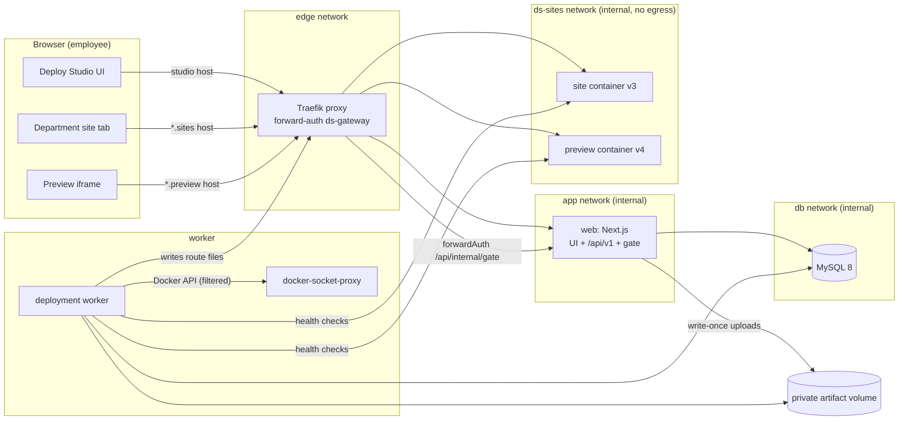
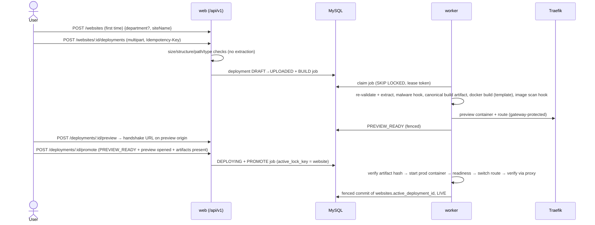
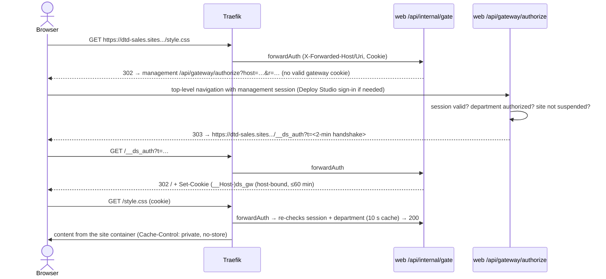

# Architecture

Deploy Studio is a **modular monolith** (one Next.js 16 App Router application — UI and the only HTTP API) plus a
**dedicated deployment worker**, a **Traefik** reverse proxy acting as the private website gateway, **MySQL 8** for
metadata and a **private artifact volume** for files.

## Components and trust boundaries

| Boundary | Rule |
|---|---|
| Browser ↔ web | Local email + password sign-in (`/api/v1/auth/*`, Argon2id, throttled) → opaque server session cookie (HttpOnly, SameSite=Lax), CSRF token + Origin on mutations, strict Host check, nonce CSP. The web container's `egress` network is unused today (reserved for a future SSO IdP — Planned, ADR 0002) |
| Browser ↔ hosted origins | Separate hostnames (separate registrable domains required in production); gateway cookie is host-only and bound to host + session + user |
| web ↔ worker | Only via `deployment_jobs` rows in MySQL — no HTTP between them |
| worker ↔ Docker | Only the worker, only through `docker-socket-proxy`; the web container never has a socket or Docker CLI |
| site containers | Controlled template image, non-root, read-only, `cap-drop ALL`, resource limits, `internal` network (no egress) |

Code map: `src/app` (routes, thin) → `src/server/services` (business rules: `auth.ts` sign-in/passwords, `users.ts`
enrollment, websites, deployments) → `src/server/auth` (passwords, sessions, one-time links) and `src/server/authz/policy.ts` (authorization),
`src/server/uploads` (validation), `src/server/storage` (write-once files), `src/server/gateway` (hosted-content access);
`worker/src` (`build.ts`, `release.ts`, `jobs.ts`, `reconcile.ts`, `runtime/*`, `routing/*`).

## Request flows

### Upload → build → preview → promote

The API never runs builds; it only enqueues. See [deployment-lifecycle.md](deployment-lifecycle.md).

### Private site access (every request, every asset)

## Version decisions

| Component | Version | Decision |
|---|---|---|
| Next.js | 16.4.6 | App Router; `src/proxy.ts` (Next 16 rename of middleware) sets a per-request CSP nonce; API routes excluded from the proxy so upload bodies are not buffered |
| React | 19.3.1 | Current stable |
| TypeScript | 5.9.3 | Not 7.x: typescript-eslint / eslint-plugin-react do not yet support the TS 7 native compiler |
| ESLint | 9.x | Not 10: `eslint-config-next` 16.4 depends on plugins that declare ESLint ≤ 9 |
| Prisma | 7.10.1 | npm `latest` tag pointed at an 8.0 RC; pinned the last stable. Uses the `prisma-client` generator (`src/generated/prisma`), `prisma.config.ts`, and the **`@prisma/adapter-mariadb`** driver adapter (works with MySQL 8) |
| Zod | 4.6 | Runtime validation of env, bodies and queries (`.strict()` bodies) |
| @node-rs/argon2 | 2.2.2 | Argon2id password hashing (native, no build toolchain needed). `openid-client` was removed with the OIDC integration (ADR 0002) |
| Tailwind CSS | 4.3 | Loaded **without preflight** (theme + utilities only) so the ported prototype CSS renders identically |
| Vitest | 5.1 | Projects: `unit`, `ui` (jsdom + Testing Library), `integration` (MySQL) |
| yauzl / yazl | 3.x | Streaming ZIP read with our own name/size/type validation; canonical ZIP writing |
| Traefik | v3.5 | File provider with atomic route files; `forwardAuth` for the gateway |
| MySQL | 8.4 | Tested against `mysql:8.4` |

## Differences from the HTML prototype

| Prototype | Production implementation |
|---|---|
| Local preview via `srcdoc` + data URLs (JSZip in the browser) | Server-validated, server-built preview served from an **isolated preview origin** behind the gateway; Deploy enabled only when the server reports `PREVIEW_READY` and the iframe loaded |
| Deployments stored in `localStorage` | MySQL (`websites`, `deployments`, `deployment_jobs`, `audit_logs`); `localStorage` keeps **only** the theme |
| Mock session object / client-side role | Local accounts (email + Deploy Studio password) enrolled by administrators + server sessions; role and department resolved server-side |
| Visibility by uploader (`owner`) | Visibility and actions by **department** (all members share the site); ADMIN sees all |
| Delete button | Removed; no DELETE API. Incident containment is via the admin CLI (suspend/quarantine) |
| Department `<select>` (DTD/ERP/KA hard-coded) | Free-text field (security spec §6): departments are dynamic; locked to the server-resolved department for USERs; typed values never grant membership |
| "Requested hostname (demo)" `dtd.my-dashboard` | Logical name kept for display; real hostname `<dept>-<site>.<SITES_BASE_URL host>` from configuration |
| Hostname uniqueness rejected re-uploads | Re-uploads create a new revision of the department's single website; site name fixed after creation |
| — | Added: Sign out, version history, build logs, rollback, status pills, password re-authentication prompt, password pages (`/login`, `/password`, `/account/password`), ADMIN collapsible left sidebar (Deploy Website, Enroll IDs; icon rail when collapsed, drawer on mobile) and the Enroll IDs page (`/admin/users`). USER has no sidebar |
| Light/Dark toggle, sketch outlines, centered BW logo, 75vh/min-650px preview, responsive layout | **Preserved** (prototype CSS ported verbatim into `src/app/globals.css`) |

## Deliberate deviation needing approval

Production sites run as hardened per-site nginx containers rather than a single gateway-backed static file server —
see [ADR 0001](adr/0001-static-sites-in-hardened-containers.md).
