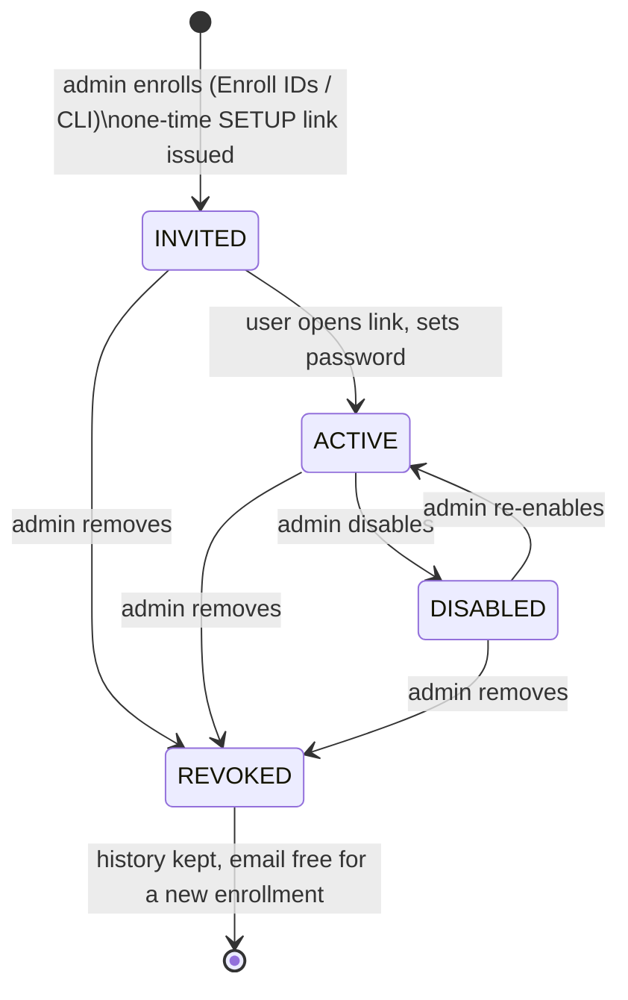

# Authentication

Deploy Studio uses **local accounts**: a corporate email address as the identifier and a password that belongs to
Deploy Studio only (it is *not* the mailbox password and is never synchronised with Microsoft 365 / Google
Workspace). Decision record: [ADR 0002](adr/0002-local-accounts.md). Security detail:
[password-security](security/password-security.md), [session-security](security/session-security.md).

| Capability | Status |
|---|---|
| Email + password sign-in, generic errors, per-IP and per-account throttling, audit | Implemented, Tested |
| Argon2id hashing, password policy (length, blocklist, personal info) | Implemented, Tested |
| Server sessions (HttpOnly, host-only, SameSite=Lax), idle + absolute expiry, rotation on login/password change | Implemented, Tested |
| Change own password (revokes every session) | Implemented, Tested — API + `/account/password` page used when a password change is required; no self-service button in the UI (owner decision 2026-11-12: admins issue reset links) |
| One-time setup / reset links (admin hands them over internally — no email delivery) | Implemented, Tested |
| "Forgot password" request (recorded for admins; no email) | Implemented, Tested |
| Password re-authentication for sensitive actions | Implemented, Tested |
| Account status checks on every request (INVITED / ACTIVE / DISABLED / REVOKED) | Implemented, Tested |
| **MFA** | **Not implemented** — deferred by the owner (2026-11-11). Release blocker (G2). |
| Corporate OIDC SSO | **Planned** — not configured; would plug into the same session model (ADR 0002) |
| Email delivery of links / breached-password corpus check | **Planned** |

## Account lifecycle

- Only `ACTIVE` accounts can sign in; any other status deletes the user's sessions on the next request.
- The first administrator is bootstrapped with the infra-only CLI:
  `npm run admin -- create-user --email <email> --name "<name>" --role ADMIN --operator <you>` → prints a setup link.

## Sign-in flow

1. `POST /api/v1/auth/login {email, password}` — Origin must be `APP_URL` (login CSRF). The email is normalised
   (NFKC, trim, lower-case) and looked up by `active_email`.
2. The password is verified with Argon2id; unknown accounts are verified against a dummy hash, so timing and the
   response (`401 INVALID_CREDENTIALS`) are identical for wrong password, unknown, disabled, invited or removed.
3. Throttling: failures count per client IP (`RATE_LIMIT_LOGINS_PER_10MIN`) and per account
   (`RATE_LIMIT_LOGIN_FAILURES_PER_ACCOUNT` per 15 min). Once over the limit even the correct password gets `429`
   until the window ends; reaching the account limit raises a `REPEATED_LOGIN_FAILURES` security alert.
4. Success → a new session. If the account must change its password, the session stage is `PASSWORD_CHANGE` and only
   `/api/v1/me`, `/api/v1/auth/change-password` and logout are reachable; everything else returns
   `403 PASSWORD_CHANGE_REQUIRED` (pages redirect to `/account/password`).
5. Hashes created with weaker parameters are transparently re-hashed after a successful login.

## Passwords

- `POST /api/v1/auth/change-password {currentPassword, newPassword}` — current password required (throttled like a
  login), policy checked server-side, must differ from the current one. All sessions of the user are revoked and a
  fresh session is returned.
- One-time links (`/password#token=…`): 256-bit random token in the URL **fragment** (never sent to servers, proxies,
  logs or Referer). Only the SHA-256 is stored; single use; `PASSWORD_LINK_TTL_HOURS` (default 24 h). Issuing a new
  link expires older ones. Completing a link sets the password, activates an invited account and revokes sessions.
  A password rejected by the policy rolls the transaction back, so the link remains usable.
- `POST /api/v1/auth/forgot-password {email}` — always `202` with the same body. For an eligible account it sets
  `password_reset_requested_at` (shown as "reset requested" in Enroll IDs) and audits the request; nothing usable is
  created. The administrator then issues a reset link and hands it over through an internal channel.

## Re-authentication

`sessions.authenticated_at` records the last password check. Every enrollment write and every cross-department
promote/rollback by an ADMIN requires it to be newer than `ADMIN_STEP_UP_MAX_AGE_MINUTES` (default 15). Otherwise the API
answers `401 REAUTH_REQUIRED`; the UI asks for the password (`POST /api/v1/auth/reauth`) and retries.

## Hosted websites and previews

Hosted origins never see the management session. The gateway hand-off (`/api/gateway/authorize`) and every gateway
decision require a **fully** signed-in session (`stage = FULL`, account `ACTIVE`). See
[private-website-gateway](security/private-website-gateway.md).

## Not verified

MFA, phishing-resistant authenticators, email ownership verification, and a breached-password corpus are not
implemented. Password-only, single-factor sign-in on an Internet-facing system is a release blocker until MFA exists
(see [release gates](security/release-gates.md)).
