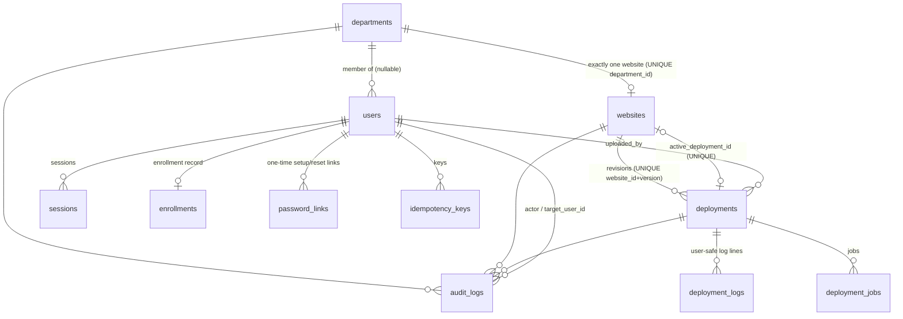

# Database (MySQL 8)

Schema: `prisma/schema.prisma` (Prisma 7, `@prisma/adapter-mariadb`). MySQL holds **metadata only**; uploaded and
built files live in private storage (`STORAGE_ROOT`). The application never deletes websites or deployments.



## Tables

| Table | Notes |
|---|---|
| `departments` | Dynamic. `code` = normalized hostname-safe key (UNIQUE), `name` = human label, `updated_at` |
| `users` | Local accounts (ADR 0002). `email` (as entered), `email_normalized` (NFKC/trim/lower-case), `active_email` UNIQUE (= normalized email while not REVOKED, NULL when REVOKED → one live account per email, history kept); `password_hash` (Argon2id PHC, NULL until the setup link is used, never returned by any API); `status` INVITED/ACTIVE/DISABLED/REVOKED; `must_change_password`, `password_changed_at`, `password_reset_requested_at`; `role` ADMIN/USER; `department_id` (set only by admin enrollment); `disabled_at`, `revoked_at`, `last_login_at` |
| `enrollments` | One per user (`user_id` UNIQUE): `created_by_user_id` (NULL = infra CLI bootstrap), `status` ACTIVE/REVOKED, `activation_state` PENDING_SETUP/ACTIVATED, `revoked_at`, `revoked_by_user_id` |
| `password_links` | One-time SETUP/RESET links: `id` = SHA-256 of the 256-bit token (the token itself is never stored), `purpose`, `created_by_user_id` (NULL = CLI), `expires_at`, `used_at` (single use) |
| `websites` | `department_id` **UNIQUE** (one site per department), `hostname` UNIQUE, `active_deployment_id` UNIQUE (production pointer), `next_version`, `suspended_at/_reason` |
| `deployments` | Immutable revision: `version` (UNIQUE per website), source/build artifact keys + SHA-256, `image_reference`, `status`, preview URL/expiry/viewed, `error_code`, `quarantined_at`, `deployed_at` |
| `deployment_jobs` | `job_type`, `status`, `attempts`, lease (`lease_token`, `lease_owner`, `lease_expires_at`), `active_lock_key` UNIQUE (per-website production lock), `from_deployment_id` |
| `deployment_logs` | Sanitized progress messages shown in the UI |
| `audit_logs` | Append-only; `action`, `result`, `request_id`, `source_ip_hash`, actor, `target_user_id` (account affected by an enrollment/password event), department/website/deployment, JSON metadata |
| `sessions` | SHA-256 of the session token, CSRF token, `stage` FULL/PASSWORD_CHANGE, `authenticated_at` (last password check, used for re-authentication), `expires_at`, `last_seen_at` |
| `idempotency_keys` | `(user_id, scope, key)` UNIQUE, request hash, stored response |
| `rate_limits` | Fixed-window counters (also used for security alert thresholds) |

All foreign keys are `ON DELETE RESTRICT` except sessions/idempotency keys (cascade with their user).

## Migrations

| Migration | Content |
|---|---|
| `20261111025403_init` | Base schema |
| `20261111030015_security_hardening` | Membership source, disabled users, suspension, quarantine, audit result/request id/ip hash, session `authenticated_at` |
| `20261111040000_audit_append_only` | `BEFORE UPDATE` / `BEFORE DELETE` triggers on `audit_logs` that raise an error for **every** account (verified: even root's UPDATE/DELETE fail) |
| `20261111070000_department_code_lowercase` | Lower-case department codes |
| `20261111090000_content_findings` | Suspicious-script findings per revision |
| `20261111120000_local_accounts_enrollment` | Local accounts (ADR 0002): new `users` columns, drops `identity_provider`/`provider_subject`/`membership_source` and `auth_flows`; `sessions.stage` (all existing sessions deleted); `departments.updated_at`; `enrollments`, `password_links`. **Every pre-existing SSO/dev user becomes a `REVOKED` legacy row** (history kept, cannot sign in, email free for a new enrollment) |
| `20261111121000_audit_target_user` | `audit_logs.target_user_id` + index `(target_user_id, created_at)` |

```bash
npm run db:migrate          # prisma migrate deploy (production / CI)
npm run db:migrate:dev      # create a new migration in development
SEED_DEPARTMENTS="DTD,ERP,KA" npm run db:seed   # optional; nothing is hard-coded; no users are seeded
npm run admin -- create-user --email <email> --name "<name>" --role ADMIN --operator <you>   # bootstrap the first admin
```

## Accounts (`infra/mysql/grants.sh`)

- `ds_migrate` — DDL + TRIGGER on `deploy_studio.*`; used only by the one-shot migration job.
- `ds_app` — `SELECT, INSERT, UPDATE, DELETE` on `deploy_studio.*`; no DDL (cannot `TRUNCATE`/`DROP`/`ALTER`);
  audit immutability is enforced by the triggers. Never run the app as root.
- Production: TLS to MySQL (`?ssl=true` in `DATABASE_URL`), private network only, passwords from a secret store.

## Backups and restore — Planned (operations)

Not implemented in this repository. Required before release: encrypted scheduled backups of MySQL **and** the artifact
volume (they must be consistent: every `source_artifact_key` / `build_artifact_key` must exist), restricted access to
backups, and a tested restore procedure (restore → `prisma migrate status` → worker reconcile rebuilds routes and
containers from the DB pointer).
