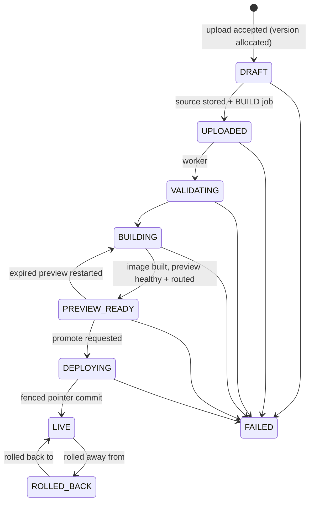

# Deployment lifecycle

Invariant: **a failed replacement never changes or stops the current production website.**
`websites.active_deployment_id` is the only production pointer; revisions (`deployments`) are immutable.

## State machine (`src/server/deployments/state.ts`)

`LIVE` means "released successfully at least once" (known-good); "active" means pointed to by the website. All
status writes go through `transition()` — a compare-and-set on the expected source status, optionally fenced.

## Jobs (`deployment_jobs`) and the worker

| Job | Created by | Does |
|---|---|---|
| `BUILD` | upload, or opening an expired preview | validate → build → preview (retried up to 3× for transient errors) |
| `PROMOTE` | `POST /deployments/:id/promote` | release a `PREVIEW_READY` revision (no automatic retry) |
| `ROLLBACK` | `POST /websites/:id/rollback` | release a previous `LIVE`/`ROLLED_BACK` revision (no automatic retry) |

- **Claiming:** `SELECT … FOR UPDATE SKIP LOCKED`, then `RUNNING` with a fresh random `lease_token`,
  `lease_expires_at = now + WORKER_LEASE_SECONDS` (default 60). Heartbeat every lease/3.
- **Fencing:** every worker write checks `id + lease_token + status=RUNNING` (`assertLease`, `completeJob`). A worker
  that lost its lease writes nothing.
- **Reaper:** expired leases → BUILD requeued (if attempts remain) or FAILED with `WORKER_LOST`; PROMOTE/ROLLBACK
  FAILED, deployment `DEPLOYING → FAILED`, then the website is reconciled.
- **Timeout:** `JOB_TIMEOUT_SECONDS` (default 900) aborts the job's Docker calls.
- **Reconciler** (`worker/src/reconcile.ts`, on start and every `RECONCILE_INTERVAL_SECONDS`): DB is the source of
  truth — ensures each website's route points at its active revision's running container; removes routes of
  suspended websites / quarantined active revisions; stops expired previews and non-active production containers
  (re-checked against fresh DB state).

## Serialization and idempotency

- **One production change per website at a time:** PROMOTE/ROLLBACK jobs set `active_lock_key = website_id`
  (UNIQUE) while QUEUED/RUNNING; requests also lock the website row (`FOR UPDATE`). A second concurrent request gets
  `409 PROMOTION_IN_PROGRESS`.
- **Uploads:** `Idempotency-Key` header (8–128 chars) → `idempotency_keys` per user/scope; same key + same archive hash
  replays the stored response; different archive → `422 IDEMPOTENCY_MISMATCH`.
- **Promote:** idempotent by state — re-requesting a `DEPLOYING` (or active `LIVE`) revision returns its current state.
- Version numbers come from `websites.next_version`, incremented under the row lock.

## Build (`worker/src/build.ts`)

1. `UPLOADED → VALIDATING`; verify the stored source hash; malware scan hook (`MALWARE_SCAN_MODE=none|clamav`; `none`
   logs a visible warning); bounded extraction with full re-validation (`src/server/uploads/archive.ts`).
2. Write the canonical, write-once **build artifact** `builds/<website>/<deployment>.zip` and its SHA-256.
3. `→ BUILDING`; render the controlled context (`infra/site-template/Dockerfile`, nginx conf with deployment id,
   `SITE_CSP`, frame-ancestors) and `docker build --network=none`; record the image id (`sha256:…`); image scan hook
   (`IMAGE_SCAN_COMMAND`, optional).
4. Start the preview container, health-check `/__ds_health` (must return the deployment id), add the
   gateway-protected route `<random-label>.<preview base>`, `→ PREVIEW_READY` with `preview_expires_at`
   (`PREVIEW_TTL_MINUTES`, default 120).

Failures remove preview resources and mark `FAILED` with a safe `error_code` (`UPLOAD_REJECTED:<reason>`,
`MALWARE_DETECTED`, `BUILD_FAILED`, …). Production is never touched by BUILD jobs.

## Preview

`POST /deployments/:id/preview` (authorized) records `preview_viewed_at` and returns a 2-minute handshake URL on the
preview origin bound to the caller's session. If the preview expired, it enqueues a restart (`RESTARTING`) from the
existing image. Promotion requires `preview_viewed_at` (server-side "preview before deploy").

## Release (`worker/src/release.ts`) — PROMOTE and ROLLBACK

1. Check state, quarantine, suspension; **verify the build artifact SHA-256** against the value recorded at validation
   (mismatch → `ARTIFACT_INTEGRITY_FAILED` + security alert). The image id itself is content-addressed; if the image
   was pruned it is rebuilt from the verified build artifact.
2. Start `ds-site-<deployment>` next to the current container; readiness check directly.
3. Re-check the lease; atomically replace the site route file (temp file + rename).
4. Verify through the proxy (`/__ds_health` with the probe token) that the new revision answers.
5. Fenced DB transaction: lock website row, ensure the pointer is still the one seen at start, set
   `active_deployment_id`, `DEPLOYING → LIVE` (rollback: target `ROLLED_BACK → LIVE` or stays `LIVE`; previous
   active `→ ROLLED_BACK`), complete the job, audit `DEPLOYMENT_LIVE` / `ROLLBACK_COMPLETED`.
6. After `DRAIN_SECONDS`, stop the previous container (its image is kept for rollback).

Any failure: restore the previous route (or remove it if there was none), stop the new container unless it became
active, mark `FAILED` (promote), audit, and reconcile. A stale worker (lease lost) only reconciles.

## Rollback

`POST /websites/:id/rollback {targetDeploymentId?}` — default target is the most recently deployed `LIVE`/`ROLLED_BACK`
revision that is not active, not quarantined and has an image + build hash. ADMIN cross-department → recent password re-authentication (`REAUTH_REQUIRED`).

## Incident controls (admin CLI only)

- `suspend-website` — gateway denies immediately (423); worker removes the route at next reconcile; uploads and
  production changes blocked.
- `quarantine-deployment` — revision can never be previewed/promoted/rolled back to; if active, the site goes offline
  until an admin rolls back to a known-good version.

Tests: `tests/integration/deployment-safety.test.ts` (fake runtime + real MySQL).
