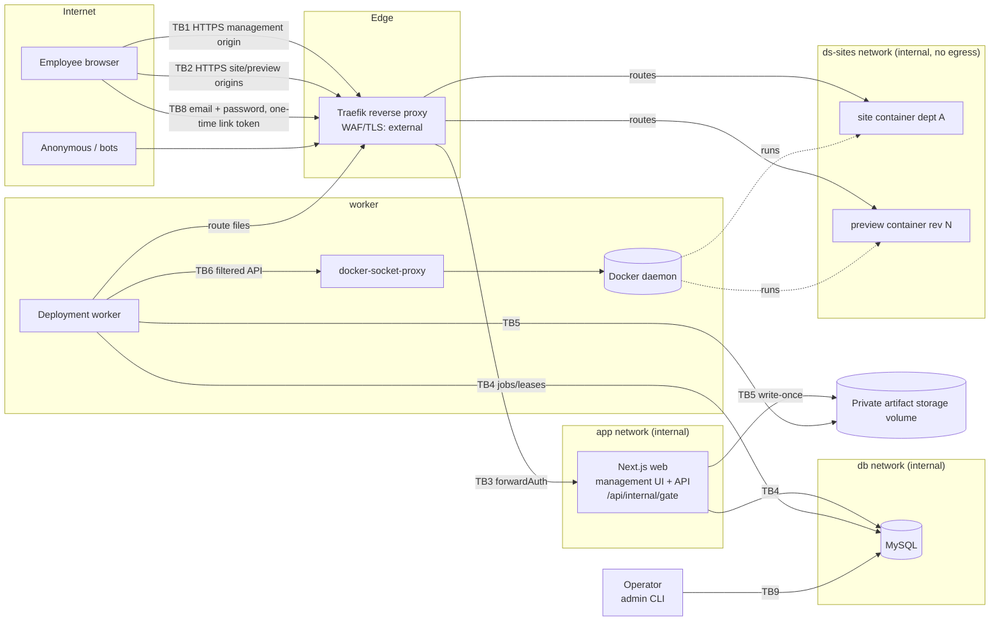

# Trust boundaries

| ID | Boundary | Crossing data | Primary controls | Status |
|---|---|---|---|---|
| TB1 | Browser ↔ management origin | session cookie, CSRF token, uploads | Server sessions from local sign-in (TB8), CSRF+Origin, Host check, nonce CSP, rate limits | Implemented, Tested |
| TB2 | Browser ↔ site/preview origins | gateway cookie, hosted content | Gateway forward-auth on every request, host-bound tokens, `private, no-store`, SITE_CSP | Gate logic Tested; proxy wiring see the local end-to-end evidence in `docs/verification.md` §3 (production infrastructure still unverified) |
| TB3 | Proxy ↔ gate | forwarded host/uri, cookies, probe header | `trustForwardHeader: false`, `authRequestHeaders` allowlist, `/api/internal` excluded from public router | Implemented (config-Tested) |
| TB4 | Web/worker ↔ MySQL | metadata, jobs, audit | internal network, DML-only account, transactions, fencing, append-only audit | Implemented, Tested |
| TB5 | Web/worker ↔ storage | archives, build bundles | server-generated keys, root confinement, `COPYFILE_EXCL`, 0440 files, SHA-256 | Implemented, Tested |
| TB6 | Worker ↔ Docker API | build contexts, container specs | socket proxy filter, template-only images, hardened `docker run` flags | Implemented; runtime-verified locally (`docs/verification.md` §3) |
| TB7 | Site containers ↔ network | HTTP from proxy only | `ds-sites` `internal: true`, no published ports | Config-Tested; host firewall Blocked by external infrastructure |
| TB8 | Browser ↔ login / password endpoints (`/api/v1/auth/*`, `/login`, `/password`, `/account/password`) — replaces the former web ↔ IdP boundary (OIDC removed, ADR 0002) | email + password (JSON body only), one-time link token (URL fragment → body), new session cookie | Origin check (login CSRF), strict bodies, Argon2id, generic errors, per-IP + per-account throttling, single-use expiring links, session rotation, `PASSWORD_CHANGE` stage, re-authentication for sensitive actions, audit — see [password-security.md](password-security.md) | Implemented, Tested; HTTPS Blocked by external infrastructure; MFA not implemented (R-25) |
| TB9 | Operator ↔ admin CLI ↔ DB | admin bootstrap, setup/reset links, disable/enable, session revocation, suspension, quarantine | infra-only access (no HTTP; compose `admin` service on the `db` network only), `--operator` attribution, audit | Implemented; operator host hardening and dual control Planned (R-20) |
